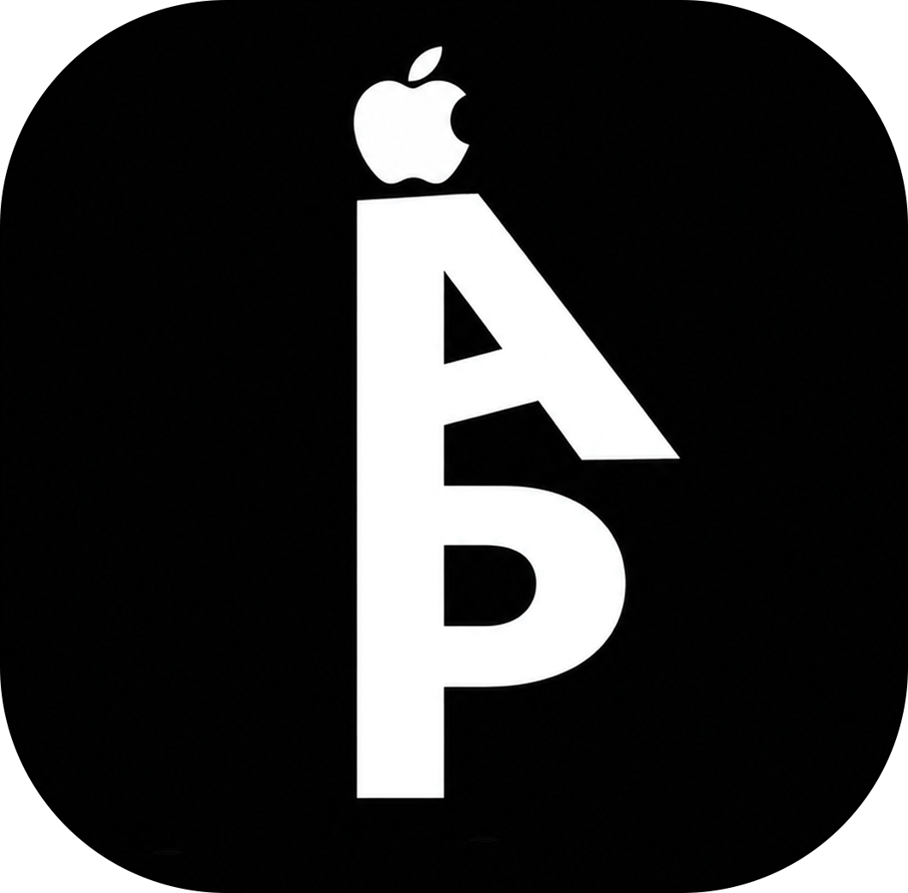

<div align="center">

<picture>
  <source media="(prefers-color-scheme: dark)" srcset="assets/logo-white.png">
  
</picture>

# IPA LOVE

**Скачивайте и устанавливайте IPA-приложения на iPhone и iPad прямо с компьютера.**

[](https://github.com/fktrc2/ipa-love/releases/latest)


[](https://github.com/fktrc2/ipa-love/releases)

</div>

---

## Скачать IPA LOVE 1.0.0

| Платформа | Файл | Размер | Загрузка |
|:--|:--|--:|:--|
| **Windows 10/11** · x64 | `IPA-LOVE-1.0.0-windows-x64.exe` | 92 МБ | **[Скачать](https://github.com/fktrc2/ipa-love/releases/download/v1.0.0/IPA-LOVE-1.0.0-windows-x64.exe)** |
| **macOS 11+** · Apple Silicon | `IPA-LOVE-1.0.0-macos-arm64.zip` | 60 МБ | **[Скачать](https://github.com/fktrc2/ipa-love/releases/download/v1.0.0/IPA-LOVE-1.0.0-macos-arm64.zip)** |

Контрольные суммы SHA-256 — в файле [`SHA256SUMS.txt`](https://github.com/fktrc2/ipa-love/releases/download/v1.0.0/SHA256SUMS.txt) и в описании релиза.

> [!IMPORTANT]
> macOS-сборка работает **только на Apple Silicon** (M1/M2/M3/M4). Версии для Intel Mac нет.
> Приложения не подписаны сертификатом Apple, поэтому при первом запуске macOS и Windows покажут предупреждение — инструкции ниже.

---

## Возможности

- Вход в **Apple Account** с поддержкой двухфакторной аутентификации и нескольких сохранённых сеансов.
- **Поиск приложений в App Store** и установка IPA на подключённый iPhone или iPad по USB.
- **История покупок** Apple Account: перенос приложений на новый iPhone и пакетная установка.
- **Сравнение** установленных на устройстве приложений с покупками и списком обновлений.
- Выбор и загрузка **старых версий** приложений.
- Сохраняемая **очередь загрузок** с прогрессом, отменой и продолжением после перезапуска.
- Локальная **библиотека IPA** с версиями, фильтрами и пакетной установкой.
- Каталог приложений, **удалённых из российского App Store** (719 позиций).
- Встроенный установщик на базе `pymobiledevice3` — iTunes не нужен.
- Интерфейс на русском языке; учётные данные хранятся в Windows Credential Manager или macOS Keychain.

---

## Установка

### Windows 10/11 (x64)

1. Скачайте `IPA-LOVE-1.0.0-windows-x64.exe` и запустите его.
2. Если появилось окно SmartScreen: **«Подробнее» → «Выполнить в любом случае»**.
3. Подключите iPhone или iPad кабелем, разблокируйте его и нажмите **«Доверять»** на устройстве.
4. На компьютере должен быть установлен **Microsoft Edge WebView2 Runtime** (в Windows 10/11 он обычно уже есть).

### macOS 11+ (Apple Silicon)

1. Скачайте `IPA-LOVE-1.0.0-macos-arm64.zip`, распакуйте архив.
2. Перетащите **IPA LOVE.app** в папку **«Программы»**.
3. Первый запуск: правый клик по приложению → **«Открыть»** → **«Открыть»**.
4. Если macOS сообщает, что приложение «повреждено», выполните в Терминале:

   ```bash
   xattr -dr com.apple.quarantine "/Applications/IPA LOVE.app"
   ```

5. Подключите iPhone или iPad кабелем, разблокируйте его и нажмите **«Доверять»** на устройстве.

---

## Требования

| | |
|:--|:--|
| Windows | Windows 10 или 11, x64, WebView2 Runtime |
| macOS | macOS 11 Big Sur или новее, Apple Silicon |
| Устройство | iPhone или iPad с кабелем; для загрузки из App Store — ваш Apple Account |
| Свободное место | около 500 МБ для приложения и загруженных IPA |

---

## Версии

| Версия | Дата | Windows | macOS |
|:--|:--|:--:|:--:|
| [1.0.0](https://github.com/fktrc2/ipa-love/releases/tag/v1.0.0) | 15.11.2026 | x64 | Apple Silicon |

Полный список изменений — в [CHANGELOG.md](CHANGELOG.md). Скачать любую версию можно в разделе [Releases](https://github.com/fktrc2/ipa-love/releases).

---

## Частые вопросы

**Приложение не подписано — это безопасно?**
Сборки публикуются без платной подписи Apple Developer ID и без нотаризации, поэтому система показывает предупреждение. Скачивайте файлы только из этого репозитория и сверяйте SHA-256.

**Это взлом App Store?**
Нет. IPA LOVE работает с вашим Apple Account и вашими покупками, не обходит DRM и не даёт доступа к чужим приложениям.

**Почему нет версии для Intel Mac?**
Приложение собирается и тестируется на Apple Silicon. Сборка для Intel в 1.0.0 не поддерживается.

**Где исходный код?**
В этом репозитории публикуются только готовые сборки. IPA LOVE распространяется по GNU GPL v3 — порядок получения исходного кода описан в [SOURCE_OFFER.md](SOURCE_OFFER.md).

---

## Лицензия

IPA LOVE распространяется по лицензии [GNU GPL v3.0](LICENSE). Сторонние компоненты и их лицензии перечислены в [THIRD_PARTY_NOTICES.md](THIRD_PARTY_NOTICES.md).
